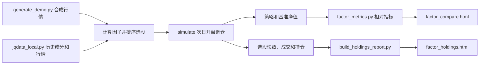

# Factor Lab 2.0

Factor Lab 把市场行情和因子选股放在同一个本地看板。v2.0 以深绿液态玻璃统一页面，调整了大盘快照、走势图、标的卡片和持仓图表的尺寸。

## 启动

下载或克隆仓库后，用 Python 3.9 或更新版本运行。行情服务使用标准库，系统需有 `curl`。

```sh
python3 market_dashboard_server.py
```

在浏览器打开 [本地看板](http://127.0.0.1:8769/)。macOS 也可双击 `启动多市场看板.command`，或运行 `./desktop/install.command` 将原生 **Factor Lab 行情看板.app** 安装到桌面。桌面版需要 macOS 13 或更新版本及 Xcode Command Line Tools，应用内可用 **⌘2** 切换置顶小窗。

- **市场行情**默认显示最近交易日的开盘至收盘曲线。历史行情支持标的搜索、多线比较、按日期选择和最长一年的回看滑杆，默认近 7 天。
- **因子选股**包括回测对比、持仓明细和因子库。公开包使用固定随机种子生成的虚构证券与价格。真实研究需要取得行情权限并在本机运行导入。
- 行情通过本地服务请求腾讯财经、东方财富、新浪财经和 FRED。各数据源的更新时间与可用字段不同。FRED 国债序列为日频。

## 重建合成演示

```sh
python3 -m venv .venv
. .venv/bin/activate
python -m pip install -r requirements.txt
python generate_demo.py
```

## 从行情到两张看板



### 1. 在信号日给股票打分

[jqdata_local.py](jqdata_local.py) 的 `build_factors()` 根据开收盘价计算 5 日反转、20 日和 60 日动量、60 日低波以及隔夜收益。[research_factors.py](research_factors.py) 补充布林带反转、RSI 反转、MACD 柱线动量和跳过近 5 日动量，每种因子的公式也会传到页面。

单因子在信号日对当时的候选股票按分数降序排序。`composite_score()` 先在共同有效且未停牌的样本内计算各因子的百分位排名，再等权取平均，得到 `MULTI` 的综合分数。`select_stocks()` 取排名靠前的指定比例，并保留逐股因子值和入选标记。

### 2. 下一交易日开盘执行调仓

真实行情流程以指定区间的首个交易日为净值基准日，先把净值设为 1；下一交易日首次执行调仓。调仓用前一交易日的信号和当时的沪深 300 成分股，之后每隔指定交易日数再调仓。

`simulate()` 在调仓日按照开盘估算组合资产，将选入股票设为等权目标，先卖后买。开盘停牌、涨停买入或跌停卖出都会受到限制。未完成的成交会体现在残留现金或原持仓里。每天收盘按持仓估值加现金计算净值。本版使用复权单位，费用、整手取整和市场冲击留作扩展。

### 3. 将净值和底层记录送到不同页面

- [factor_metrics.py](factor_metrics.py) 用同日策略与基准净值计算两种视图。**累计收益差**以百分点表示；**相对净值**是策略净值除以基准净值，还可由此计算相对回报和相对最大回撤。
- [refresh_factor_page.py](refresh_factor_page.py) 校验真实数据导出里的来源、日期、净值长度和起点，然后替换 [factor_compare.html](factor_compare.html) 内的数据块。主页面负责画图、切换策略和展示指标。合成演示由 `generate_demo.py` 写入同一页面。
- [build_holdings_report.py](build_holdings_report.py) 将调仓快照、成交、日末持仓和开盘行情按日期与股票拼起来，写入 [factor_holdings_template.html](factor_holdings_template.html) 模板。持仓页面能追溯某只股票的选股分数、调仓前后仓位、买卖金额和受限原因。

## 使用自己有权访问的行情

安装聚宽依赖，复制 [jqdata_credentials.example.json](jqdata_credentials.example.json) 为本机的 `jqdata_credentials.json`，填入自己的账号信息。生成的配置与行情缓存由本机保管。

```sh
python -m pip install -r requirements-jqdata.txt
cp jqdata_credentials.example.json jqdata_credentials.json
# 填写本机配置后，指定具备数据权限的区间
python jqdata_local.py --start 2025-08-15 --end 2026-07-15 --rebalance 20 --top-pct 0.2
```

| 产物 | 用途 |
| --- | --- |
| `data/jqdata_*/prices_adjusted.csv` · `universe.json` | 复权行情、历史成分股与信号日映射 |
| `factor_snapshots.csv` | 每次调仓的股票分数、信号日、执行日和入选状态 |
| `trades.csv` · `holdings.csv` | 成交明细和按日估值的持仓与现金 |
| `factor_data_jq.json` · `factor_data.json` | 策略与基准净值和指标，供更新主看板 |
| `factor_compare.html` · `factor_holdings.html` | 两个可直接打开的页面，真实数据运行后会更新 |

[add_factor_composite.py](add_factor_composite.py) 与 [add_research_factors.py](add_research_factors.py) 用已有的聚宽行情缓存重算对应组合或补充因子。[mine_research_factors.py](mine_research_factors.py) 在本地历史数据上比较候选因子和持股比例，输出 `factor_mining_screen.csv`。筛选结果用于提出后续检验的假设。

重新分享演示时，可以运行 `python generate_demo.py` 切回合成样例。真实基准采用沪深 300 价格指数，组合使用复权口径，解读收益差时需要区分两者的分红处理。

## 测试

```sh
python -m unittest test_jqdata_local
```

[test_jqdata_local.py](test_jqdata_local.py) 验证简化成交与净值计算，并检查更新看板时的数据来源和数据块替换。
